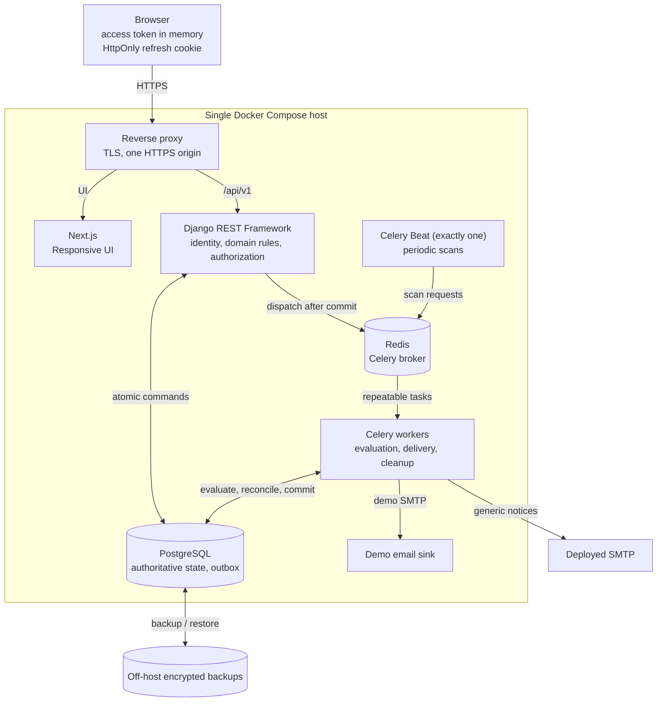
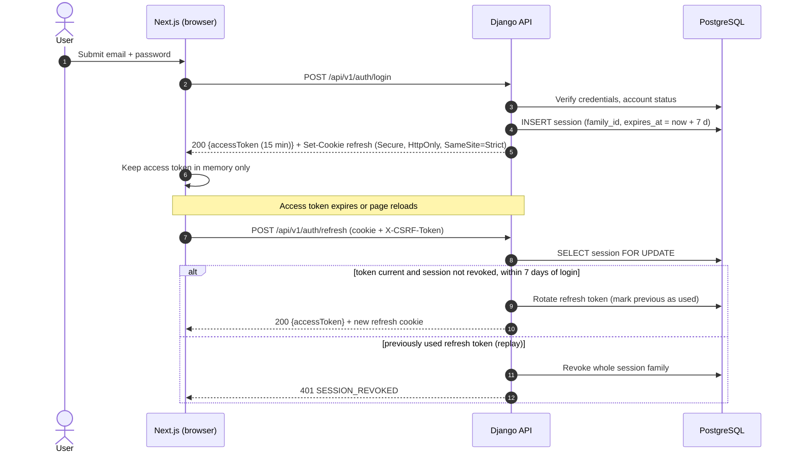
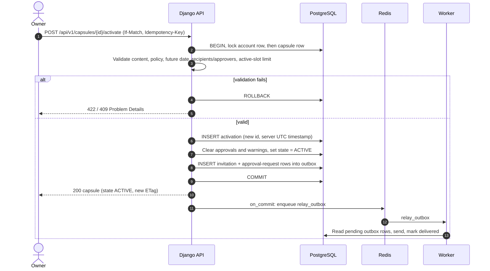
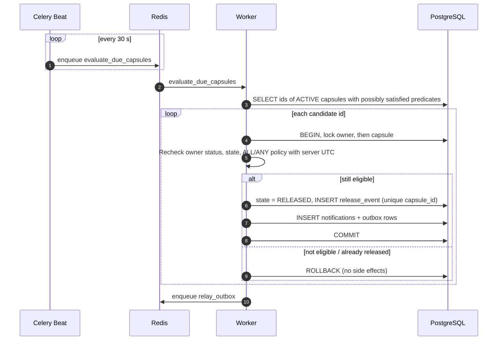

# Dead Drop: Architecture

This document details the architecture allocated in [SRS Chapter 4](srs.md#4-high-level-architecture). Diagrams are written as code in [Mermaid](https://mermaid.js.org/) and render directly on GitHub. The Graphviz sources in [diagrams/](diagrams/) remain the figures embedded into the SRS PDF.

## 1. Architectural style

Dead Drop is a **modular monolith with a single-page frontend and asynchronous workers**, deployed on one Docker Compose host:

* **SPA + BFF-less API.** Next.js serves the responsive UI; the browser calls the Django REST Framework API on the same HTTPS origin through a reverse proxy.
* **Modular backend.** One Django codebase is split into domain modules (identity, capsules, policy, participants, notifications, administration, audit). The API, Celery workers, and Celery Beat run the same image with different commands, so domain rules are shared rather than duplicated.
* **Database as the source of truth.** PostgreSQL holds all authoritative state, including pending work. Redis is only a broker: losing it delays work but never loses releases or notifications.
* **Event-driven background processing.** Release evaluation, email delivery, and cleanup run in workers with at-least-once semantics and idempotent handlers (see [concurrency.md](concurrency.md)).

Microservices and serverless were rejected for the course MVP: the domain requires multi-entity atomic transactions (owner + capsule + approvals + notifications) that a single database makes simple, and a single host matches the accepted availability boundary in SRS §7.4.

## 2. Component view

| Component | Responsibility | Key requirements |
| --- | --- | --- |
| Reverse proxy | TLS termination, routing `/` to Next.js and `/api/v1` to Django, request-size limits, edge rate limiting. | REQ-SEC-003 |
| Next.js | UI screens from SRS §7.1; keeps the access token only in memory; never decides release. | REQ-USE-001, REQ-PORT-001, REQ-SEC-001 |
| Django API | Registration, sessions, capsule commands, policy validation, object-level authorization, Problem Details errors. | REQ-FUNC-001…014, 019, 022, 023, 026…030, REQ-SEC-002 |
| PostgreSQL | Accounts, capsules, activations, grants, approvals, warnings, sessions, notification outbox, audit metadata. | REQ-REL-001, REQ-SEC-004, REQ-COMP-001 |
| Redis | Carries task identifiers only; no message text. | REQ-REL-002 |
| Celery Beat | Single scheduler emitting evaluation and recovery scans every 30 s. | REQ-PERF-002, REQ-REL-002 |
| Celery workers | Condition evaluation, atomic release, outbox relay to SMTP, deletion cleanup. | REQ-FUNC-015…018, 021, 024, 025 |
| SMTP / email sink | Transport for generic notices; no release authority. | REQ-FUNC-024, REQ-FUNC-025 |

## 3. Key flows

### 3.1 Login and refresh-token rotation

### 3.2 Capsule activation

### 3.3 Periodic evaluation and release

## 4. Deployment summary

The deployment view is in [SRS §4.2](srs.md#42-components-and-deployment). The containers are `proxy`, `frontend`, `api`, `worker` (scalable), `beat` (exactly one replica), `postgres`, `redis`, and `mailpit` (demo email sink). Secrets (SMTP credentials, encryption and signing keys) come from environment variables or Docker secrets and are never baked into images.
