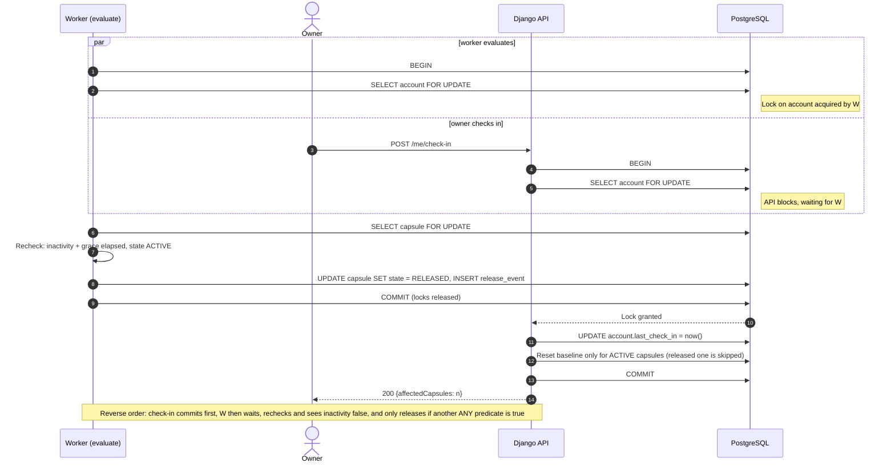
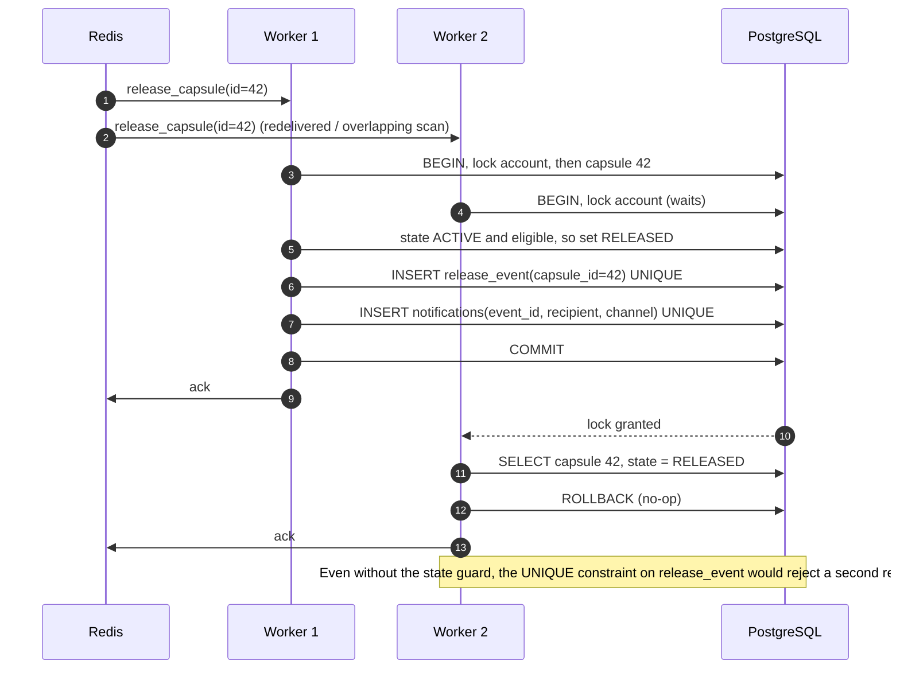
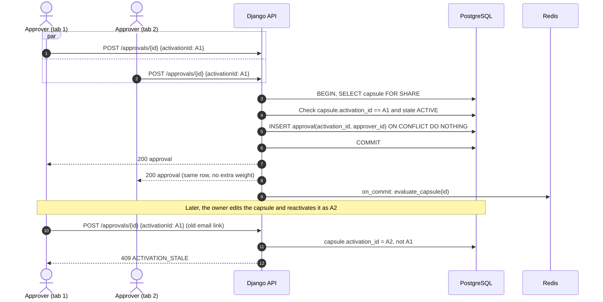
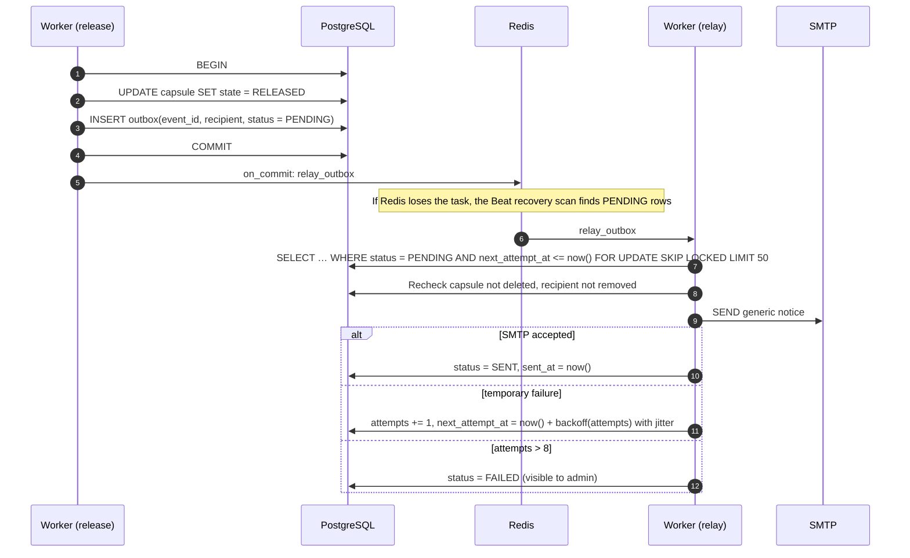
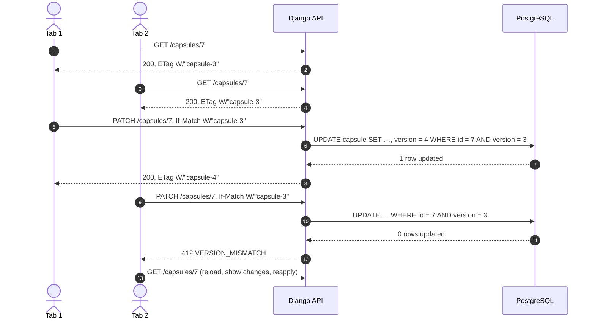
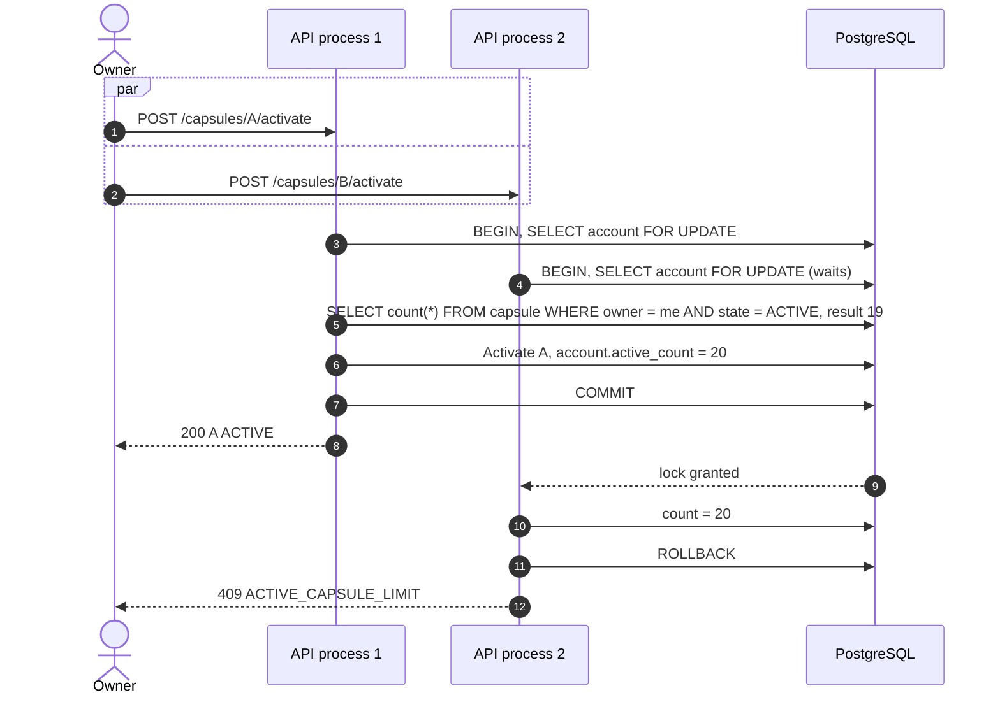
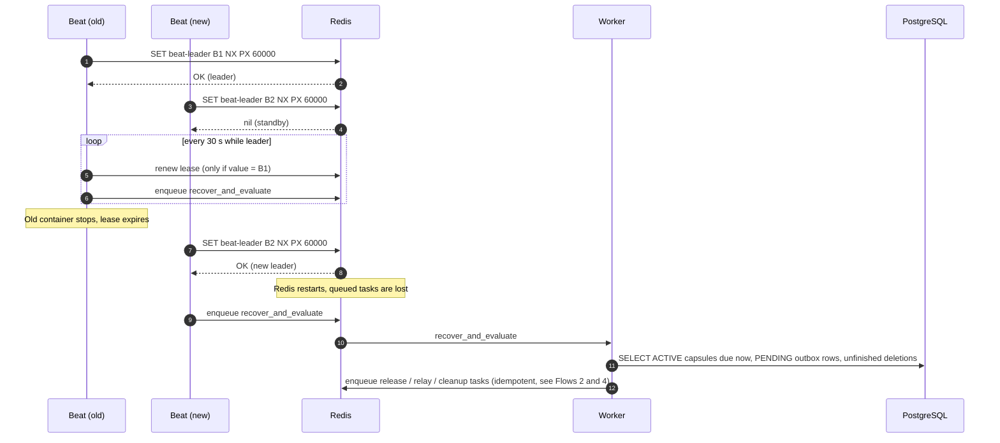

# Dead Drop: Concurrency and Distributed Patterns

Dead Drop runs several API processes and several Celery workers against one PostgreSQL database. Work is delivered at least once through Redis, and users act from multiple tabs and devices. This document lists the seven flows where concurrency matters, shows each one as a sequence diagram, and explains which pattern guarantees the required outcome from [SRS §4.5](srs.md#45-evaluation-concurrency-and-release) and [§9.2](srs.md#92-lifecycle-transition-and-race-tables).

## Shared rules

* **PostgreSQL is the single source of truth.** Redis messages contain only identifiers. Any task may be lost, repeated, or reordered without corrupting state.
* **Fixed lock order: account → capsule → activation rows.** Every transaction that touches more than one of them locks them in this order with `SELECT … FOR UPDATE`, which prevents deadlocks between release, check-in, suspension, and edits.
* **Recheck after lock.** Eligibility read outside a lock is only a hint. The decision is recomputed after the locks are held.
* **Side effects after commit.** Emails and task dispatch happen only from committed outbox rows (`transaction.on_commit`), never inside the transaction.

## Flow 1. Release vs account-wide check-in

**Context.** A capsule with `DATE OR INACTIVITY` (or `INACTIVITY` alone) is evaluated by a worker exactly when the owner presses "I'm alive". Both transactions read the same owner baseline. SRS §9.2 requires the outcome to follow the commit order: a committed check-in forces reevaluation, while a committed release stays permanent.

**Pattern: pessimistic locking with a fixed lock order and recheck-after-lock.** Both transactions serialize on the account row, so they can never act on an inconsistent owner state. The worker recomputes eligibility after obtaining the locks, which makes the result follow the commit order exactly as specified. The same discipline covers release vs pause, edit, deletion, and suspension: each of them locks account → capsule and checks `state = ACTIVE` before changing anything.

**Requirements:** REQ-FUNC-019, REQ-FUNC-021, REQ-FUNC-027; scenario SC-11.

## Flow 2. Duplicate release tasks (at-least-once delivery)

**Context.** Beat requests a scan every 30 seconds. A slow scan can overlap with the next one, a worker can crash after commit but before acknowledging the task, and Redis can redeliver it. Two workers may therefore try to release the same capsule.

**Pattern: idempotent consumer + at-least-once delivery.** Tasks are allowed to repeat, so the handler is idempotent. A state guard (`state = ACTIVE`) and a unique `release_event.capsule_id` constraint guarantee one logical release. Unique `(event_id, recipient, channel)` keys guarantee one logical notification. Celery runs with `acks_late=True` so a crash before commit leads to redelivery, not loss.

**Requirements:** REQ-FUNC-021, REQ-REL-002; scenarios SC-11, SC-17.

## Flow 3. Concurrent and stale approvals

**Context.** An approver double-clicks "Approve" or opens the link on two devices. Meanwhile the owner may edit the capsule, which invalidates the activation. An old link from activation A1 must not authorize activation A2.

**Pattern: unique constraint as a concurrency control + versioned tokens.** `UNIQUE(activation_id, approver_id)` with `ON CONFLICT DO NOTHING` makes concurrent approvals converge on one row without locks or retries. The activation id acts as a version token: approvals are scoped to it, and an edit or pause replaces it, so stale links are rejected. `FOR SHARE` on the capsule blocks a concurrent edit or pause (which takes `FOR UPDATE`) until the approval commits, so an approval cannot land in an activation that is being invalidated.

**Requirements:** REQ-FUNC-016, REQ-FUNC-012; scenario SC-09.

## Flow 4. Notifications: transactional outbox and retry

**Context.** A release must atomically make content readable **and** schedule notices. If the email were sent inside the transaction, a rollback would leave a sent email for an unreleased capsule. If it were sent after commit directly, a crash would lose it.

**Pattern: transactional outbox + polling publisher + retry with exponential backoff and jitter.** Domain state and pending notifications commit in one transaction. The relay delivers from committed rows only. `FOR UPDATE SKIP LOCKED` lets several relay workers drain the outbox in parallel without picking the same row. Backoff (1 min, 2 min, 4 min, … capped at 6 h, ±20 % jitter) avoids hammering a failing SMTP server. Email status never changes release status.

**Requirements:** REQ-FUNC-024, REQ-FUNC-025, REQ-REL-002; scenario SC-13.

## Flow 5. Concurrent edits from two tabs

**Context.** The owner edits a draft in a laptop tab and a phone tab. Without control, the last save silently overwrites the other one (lost update).

**Pattern: optimistic concurrency control (version column + HTTP ETag / If-Match).** Edits are rare and short, so locking a row while a user types would be wasteful. A compare-and-set on `version` detects the conflict at write time. A missing `If-Match` returns `428`. If the edited capsule was ACTIVE, the same transaction also pauses it and replaces the activation (Flow 3 then rejects stale approvals).

**Requirements:** REQ-FUNC-005, REQ-FUNC-012; scenario SC-07.

## Flow 6. Active-capsule limit under concurrent activation

**Context.** An owner with 19 active capsules sends two activation requests at once (two tabs or a double click). A naive `COUNT(*) < 20` check in both transactions would pass and leave 21 active capsules.

**Pattern: serialized check-then-act on an aggregate root.** The account row is the aggregate root for "active slots", and locking it turns the check and the insert into one critical section. A `CHECK (active_count <= 20)` constraint on the denormalized counter is a second line of defense. The `Idempotency-Key` header additionally prevents a network retry from activating the same capsule twice.

**Requirements:** REQ-FUNC-006, REQ-FUNC-011; scenario SC-11.

## Flow 7. Single scheduler and recovery scan

**Context.** SRS §4.2 requires exactly one Celery Beat. During a redeploy two Beat containers may briefly overlap, and Redis may restart and lose queued tasks.

**Pattern: leader election with a lease (distributed lock) + reconciliation loop.** A Redis lease with expiry keeps one active scheduler while allowing automatic failover. Correctness never depends on the lock: if two schedulers ever run, the idempotent handlers from Flows 2 and 4 absorb the duplicates. The recovery scan rebuilds all work from PostgreSQL, so no long-lived Celery countdown is the only record of a future release.

**Requirements:** REQ-REL-002, REQ-PERF-002, REQ-AVAIL-001; scenario SC-17.

## Pattern summary

| Pattern | Flows | Guarantee |
| --- | --- | --- |
| Pessimistic locking (`SELECT … FOR UPDATE`) with fixed lock order | 1, 2, 6 | Outcome follows commit order, no deadlocks. |
| Recheck after lock | 1, 2, 4 | Decisions use current, not stale, state. |
| Idempotent consumer + at-least-once delivery | 2, 4, 7 | Exactly one logical release and notice per event. |
| Unique constraint / `ON CONFLICT DO NOTHING` | 2, 3 | Duplicate inserts converge without retries. |
| Versioned tokens (activation id) | 3 | Stale approval links cannot authorize new activations. |
| Transactional outbox + polling publisher | 4, 7 | No lost or premature emails. |
| `SKIP LOCKED` competing consumers | 4 | Parallel relay workers without double send. |
| Retry with exponential backoff and jitter | 4 | Bounded, polite SMTP retries. |
| Optimistic concurrency (ETag / version) | 5 | No lost updates between tabs. |
| Serialized check-then-act on aggregate root | 6 | Active-capsule limit holds under concurrency. |
| Leader election with lease + reconciliation | 7 | One scheduler, full recovery after broker loss. |
