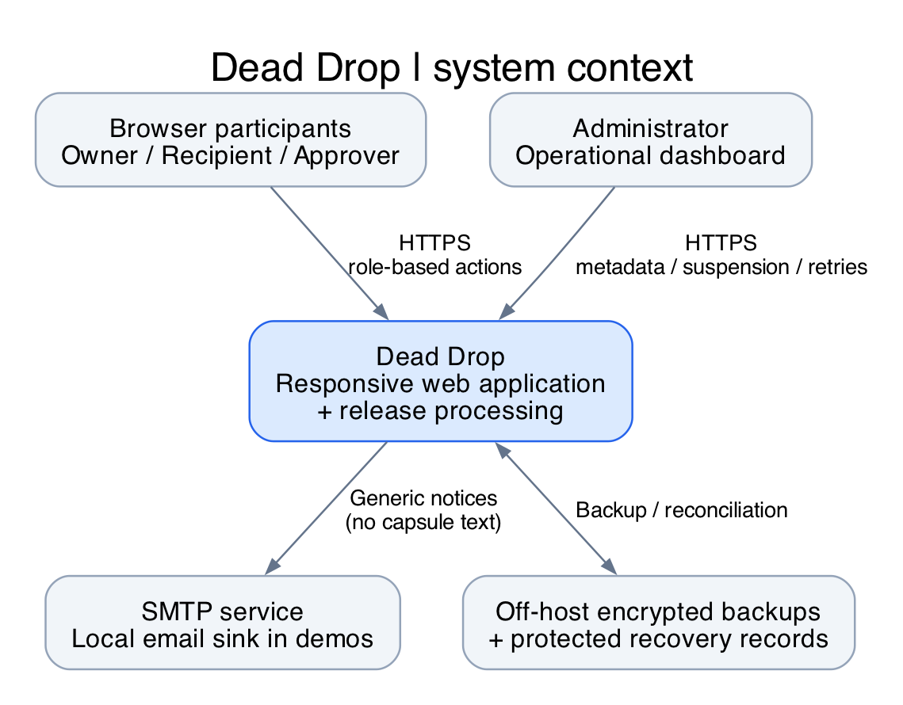
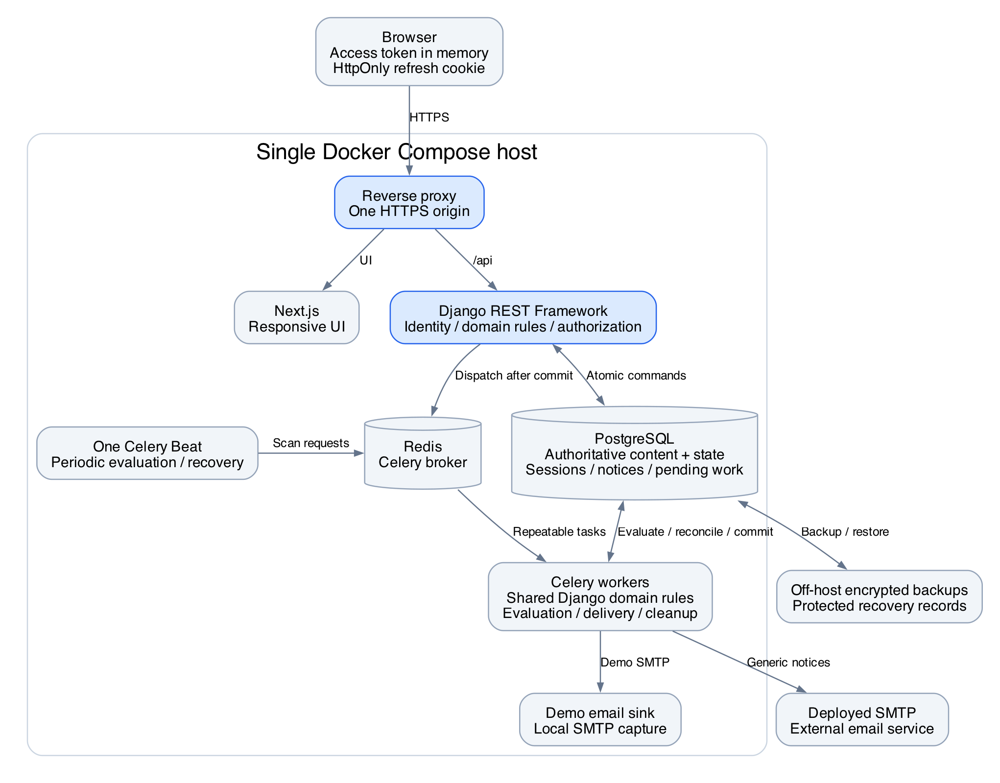
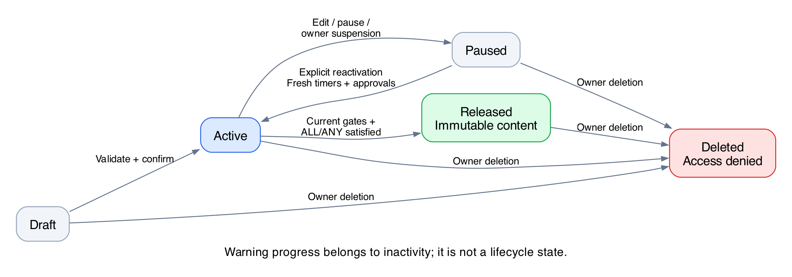

# Dead Drop

Software Requirements Specification

**Version:** 0.1

**Prepared by:** Dead Drop Team

**Course:** Object-Oriented Analysis and Software Design

**Preparation date:** 2026-10-20

**Status:** Requirements baseline for a course MVP; implementation and application verification are planned.

## Contents

- [1. Introduction](#1-introduction)
- [2. Product Overview](#2-product-overview)
- [3. Actors/Personas](#3-actorspersonas)
- [4. High-level Architecture](#4-high-level-architecture)
- [5. Functional Requirements](#5-functional-requirements)
- [6. Non-functional Requirements](#6-non-functional-requirements)
- [7. External Interfaces and Implementation Constraints](#7-external-interfaces-and-implementation-constraints)
- [8. Verification and Traceability](#8-verification-and-traceability)
- [9. Appendices](#9-appendices)

## Revision History

| Version | Date | Author | Change |
| --- | --- | --- | --- |
| 0.1 | 2026-10-20 | Dead Drop Team | Initial course MVP requirements, architecture, and planned verification baseline. |

## 1. Introduction

### 1.1 Purpose and audience

This SRS defines the externally observable behavior, quality targets, and agreed architecture constraints of the Dead Drop course MVP. It gives the development team a baseline for design and implementation, the verification team a basis for acceptance scenarios, and course reviewers a traceable explanation of scope and design intent. It specifies intended behavior rather than claiming that an application already exists or that its targets have been achieved.

### 1.2 Product scope

Dead Drop lets people prepare private plain-text messages for future access by designated recipients. An owner can schedule a capsule, require approval from trusted people, require a period without an explicit check-in, or combine these conditions using ALL or ANY. The MVP supports personal time capsules and practical emergency handover equally. Release means that the server grants access to eligible recipients; it does not mean that an email reached an inbox or that a recipient read the message.

The broader project vision includes files, but this MVP contains text only. It does not provide legal inheritance processing, certify that an owner is deceased, guarantee emergency intervention, or promise preservation over decades. Server-managed security permits the backend and privileged infrastructure operators to process content; it is not end-to-end encryption. Administrator dashboard permissions remain restricted as specified below.

### 1.3 Conventions and glossary

"Shall" denotes a mandatory MVP obligation. Every requirement has priority **Must**; deferred capabilities are listed separately and are not MVP obligations. IDs are stable references: `REQ-FUNC-NNN` identifies functional behavior; other areas identify non-functional qualities. `USE` denotes usability and `PORT` denotes browser portability. Acceptance criteria are conjunctive unless explicitly joined by OR. Verification references link to planned scenarios, not executed tests.

| Term | Meaning |
| --- | --- |
| Activation | Validation and transition of a draft or paused capsule into active evaluation. |
| Active capsule | A capsule in the active lifecycle state, including one whose inactivity warning is pending. |
| Approver | A verified account designated to authorize release; approval does not grant message access. |
| Capsule | An owner's message, recipients, policy, lifecycle state, and associated operational history. |
| Check-in | A deliberate authenticated action indicating that the owner remains active. Login alone is insufficient. |
| Condition | One selected date/time, approval, or inactivity predicate. |
| Grace period | Seven elapsed days starting when an inactivity warning is durably recorded in-app. |
| Healthy operation | API, database, broker, scheduler, and workers operating within the defined reference load without an injected outage. SMTP availability is not required for release. |
| Inactivity baseline | The later of a capsule's latest activation time and the owner's latest explicit check-in. |
| Logical notification | One event-recipient-channel record, potentially requiring multiple transport attempts. |
| Owner | The verified account controlling a capsule before release and its deletion afterward. |
| Recipient | A designated verified account allowed to read content after release, unless access has been removed. |
| Release | A committed, irreversible transition from active to released, subject to later deletion and account restrictions. |
| SMTP acceptance | The email service accepts a message; inbox delivery and reading remain unproven. |
| UTC | Coordinated Universal Time; the authoritative time basis for server decisions. |

### 1.4 References

These are informative sources unless an explicit requirement in this document makes a behavior mandatory. Online documentation was consulted on 2026-10-20; links do not mandate particular software versions or every capability described there.

- **R1.** Dead Drop Team, [project README](../README.md), repository product vision and course context; current checkout on the preparation date.
- **R2.** jam01, [SRS template](https://github.com/jam01/SRS-Template/blob/master/srs-template.md), current template consulted on the preparation date. This SRS adapts its introduction, overview, interface, requirement, and verification structure. The previously supplied `template.md` location is obsolete. This is not a claim of standards certification.
- **R3.** Celery project, [Periodic Tasks](https://docs.celeryq.dev/en/stable/userguide/periodic-tasks.html), stable documentation: scheduler ownership and overlapping-task concerns.
- **R4.** Celery project, [First steps with Django](https://docs.celeryq.dev/en/stable/django/first-steps-with-django.html), stable documentation: integration and dispatch after database commit.
- **R5.** Celery project, [Using Redis](https://docs.celeryq.dev/en/stable/getting-started/backends-and-brokers/redis.html), stable documentation: broker behavior and redelivery considerations.
- **R6.** Django REST Framework project, [Authentication](https://www.django-rest-framework.org/api-guide/authentication/) and [Permissions](https://www.django-rest-framework.org/api-guide/permissions/), current documentation: identity and authorization are distinct responsibilities.
- **R7.** Simple JWT project, [Settings](https://django-rest-framework-simplejwt.readthedocs.io/en/stable/settings.html), stable documentation: access/refresh token lifetimes, rotation, and revocation mechanisms. The library is informative, not mandated.
- **R8.** Next.js project, [Deploying](https://nextjs.org/docs/app/getting-started/deploying), current documentation: self-hosted Node.js and Docker deployment options.

### 1.5 Document organization and maintenance

Chapters 2-4 explain product boundaries, people, and architecture. Chapters 5-7 define behavior, measurable qualities, and interface constraints. Chapter 8 maps every requirement to a planned verification scenario; Chapter 9 supplies worked use cases and decision tables. Changes retain requirement IDs and update the revision history. Markdown is the source of truth; the PDF is regenerated from it, including the same diagram images.

## 2. Product Overview

### 2.1 Perspective and major capabilities

Dead Drop is a new, independent responsive web application developed by a student team. The repository initially contains a product README and no implementation. The application will support verified accounts, capsule authoring, recipient invitations, independent trusted approvals, explicit check-in, condition evaluation, controlled release, notifications, and an operational administrator dashboard.

The frontend communicates with the Django REST API. The API and background workers share the same domain rules and PostgreSQL data. External SMTP delivery is advisory: recipient authorization is always determined by committed application state.

### 2.2 Fixed MVP boundaries

| Constraint | Agreed value or rule |
| --- | --- |
| Message | Plain text; 1-20,000 Unicode code points on activation; a draft may be incomplete. |
| Active capsules | At most 20 per owner; activating a paused capsule counts toward this limit. |
| Recipients | 1-10 distinct verified-email identities per activated capsule; the owner may be included. |
| Approvers | 1-10 distinct identities if approval is selected; the owner is excluded. |
| Date/time | Later than server now and at most five calendar years ahead on each activation. |
| Inactivity | Integer interval of 1-365 elapsed days, followed by seven elapsed days of grace. |
| Combination | One or more condition types, each at most once; one flat ALL or ANY operator. |
| Identity | Fixed verified email; password recovery supported; email-address changes deferred. |
| Platform | English responsive web interface; online access required. |

An elapsed day is 24 hours regardless of daylight-saving changes. For the five-calendar-year upper bound, an invalid leap-day anniversary is clamped to the last day of that month, retaining UTC time of day. Email matching uses the same canonical identity for registration, invitations, and authorization; leading/trailing whitespace and letter case do not create distinct identities. Provider-specific aliases are not inferred.

### 2.3 Assumptions, dependencies, and failure impact

| Assumption or dependency | Impact if unavailable or false | Required response |
| --- | --- | --- |
| Participants control the invited email address. | A mistyped address can invite the wrong person. | Require verified ownership; show recipients and policy before activation. |
| Deployment host clock is synchronized. | Early or late evaluation becomes possible. | Use server UTC, monitor time synchronization, and investigate clock faults. |
| PostgreSQL is authoritative and recoverable. | Mutations and reliable access decisions cannot complete. | Reject affected operations without claiming success; recover under the backup policy. |
| Redis, workers, and Beat are operating. | Releases and notifications can be delayed. | Recover pending work from PostgreSQL after service restoration. |
| SMTP is configured and reachable. | Email verification and notices can be delayed. | Retain in-app state and notification attempts; do not bypass verification or alter release rules. |
| Team provisions encrypted storage and an independent backup location. | Data protection and host-loss recovery targets cannot be met. | Verify deployment controls; Compose alone does not provide these guarantees. |
| Users understand ALL/ANY and check-in. | Content could release earlier than the owner expects. | Display a plain-language policy summary and explicit activation confirmation. |

### 2.4 Allocation and deferred work

All requirements in Chapters 5 and 6 belong to the course MVP. The frontend handles presentation and interaction; Django owns identity, permissions, validation, and domain transitions; PostgreSQL owns durable state; workers execute evaluation, cleanup, and delivery attempts; the deployment environment provides TLS, encrypted volumes, backups, and monitoring.

Deferred work includes files, native applications, offline operation, SMS, nested condition expressions, email-address changes, MFA, end-to-end encryption, payment plans, AI/ML, legal inheritance workflows, multi-host high availability, and indefinite preservation. No external certification, institution-specific policy, hosting vendor, budget, deadline, or library version is assumed.

## 3. Actors/Personas

### 3.1 Roles and permissions

Roles describe participation, not mutually exclusive account types. One person can own some capsules and receive or approve others. An approver may also be a recipient of the same capsule, but these grants are independent. Administrator privileges alone never confer a participant's message access.

| Action | Owner | Recipient | Approver | Administrator |
| --- | --- | --- | --- | --- |
| Read message before release | Own capsule | No | No | No dashboard access |
| Read message after release | Own capsule | If designated and access retained | Only if also recipient | Only under a separate participant grant |
| Edit or pause before release | Own capsule | No | No | No |
| Delete a capsule | Own capsule, including released | No; may remove own access | No | No |
| Approve release | Never own capsule | Only if also designated approver | Designated capsule | Only under a separate approver grant |
| Reset inactivity | Own account-wide check-in | No | No | No |
| Inspect account/job metadata | Own relevant status | Own relevant status | Own relevant status | Operational scope |
| Suspend/restore accounts; retry failed email | No | No | No | Yes, audited |

### 3.2 Owner persona: Maya, a personal time-capsule author

Maya wants to prepare a message for her sibling's future birthday. She uses a phone browser occasionally, has ordinary web-account skills, and needs a clear date/time preview rather than knowledge of UTC. She writes a draft, chooses her sibling's email, selects a future date, reviews the policy, and activates. Success means the message remains private before the date and becomes accessible afterward, even if her sibling registers later. Her risks are a mistyped email, an incorrect time zone, and misunderstanding ANY when combining conditions.

### 3.3 Owner persona: Anton, an emergency-handover planner

Anton wants a family member to obtain practical instructions if he stops checking in. He selects inactivity AND trusted approval so inactivity alone is insufficient. He is comfortable with basic web forms but may not visit regularly; the explicit check-in action and seven-day warning must be easy to recognize. Success means he can prevent an unintended release by checking in before it commits, while designated trusted people can independently supply the required approvals. The platform does not determine his health or legal status.

### 3.4 Recipient persona: Iryna, an occasional invitee

Iryna receives an invitation and may create her account only after release. She needs to understand why content is locked, verify the invited email, and read without seeing policy-management controls. She can dismiss an invitation or permanently remove her own access to that capsule. Success means she receives only content intended for her and cannot see messages through another user's URL or an old email link.

### 3.5 Trusted-approver persona: Bohdan, a designated contact

Bohdan signs in after an approval request, sees the owner and release-policy summary, and decides whether to approve. He does not see the message unless separately designated as a recipient after release. He may leave the request unanswered; there is no veto action. The UI explains that approval persists for that activation and cannot be withdrawn, so he must confirm before submitting.

### 3.6 Administrator persona: Olena, the course service operator

Olena checks delivery failures and worker health, investigates metadata, and suspends abusive accounts. She has technical operational skills and uses the dashboard more frequently than recipients. Success means restoring service without viewing message text or overriding release rules. Database-host access remains a separate privileged infrastructure capability; a restrictive dashboard does not make the server unable to decrypt data.

## 4. High-level Architecture

### 4.1 System context

All people use a browser and the same public HTTPS origin. SMTP is an external dependency; a local email sink substitutes for it during demonstrations. Backup storage is outside the application host's failure boundary. Context arrows describe responsibilities rather than a public API contract.

### 4.2 Components and deployment

The reverse proxy terminates HTTPS and routes UI requests to Next.js and API requests to Django REST Framework. The Next.js client supplies the interface and in-memory access-token handling. Django owns registration, verified identity, capsule policy, participant permissions, check-in, and administrator operations. A modular backend keeps these responsibilities separate while sharing domain rules with Celery workers.

PostgreSQL stores accounts, capsule text and state, participant grants, activation-scoped approvals, warning progress, in-app notifications, pending email records, revocable sessions, and metadata-only audit events. These are conceptual responsibilities, not a prescribed physical schema. Redis carries work requests; it is not the sole store of future deadlines or pending delivery. A single Beat process periodically requests evaluation and recovery scans; workers may run concurrently and therefore require transaction-safe domain operations. R3 documents both the single-scheduler constraint and the possibility of overlapping tasks.

Docker Compose describes the proxy, frontend, API, database, Redis, worker, Beat, and demonstration email sink. The same backend image can serve API, worker, and scheduler processes with different commands. Deployed SMTP credentials and encryption keys are secrets supplied by the environment. TLS, encrypted disks, off-host backups, and host monitoring require deployment configuration beyond simply starting containers.

### 4.3 Authentication and browser trust boundary

The user submits credentials over HTTPS to Django. An unverified account can verify its email or recover access, but cannot activate, approve, check in, or read capsules. Login establishes a revocable server-tracked session: a 15-minute access token is held only in browser memory and a rotating refresh token is stored in a Secure, HttpOnly cookie. Refresh cannot extend the session past seven days from the original login. Reloading the page obtains a new access token through the refresh flow; tokens are not persisted in localStorage or sessionStorage.

The frontend sends the access token to the API. Django checks current account status, session revocation, and object-level permissions before acting; token validity alone is insufficient. Cookie-authenticated operations such as refresh and logout require CSRF protection and origin validation. Logout and password reset revoke the relevant session or sessions, and subsequent requests with their access tokens are rejected. Invalid tokens never disclose capsule text. R6 and R7 inform these responsibilities; default library settings alone do not establish this full policy.

### 4.4 Activation and policy data flow

The owner saves an incomplete draft, supplies content, recipients, and conditions, then reviews the complete release summary. Django validates all limits, requires a future date where selected, checks account status and the active-capsule count, and commits activation with a new activation identity and timestamp. Activation clears earlier approvals and warning progress. It records recipient invitations and approval requests durably; asynchronous dispatch follows the commit as described by R4. A recovery scan also picks up committed pending records if broker dispatch fails.

Approvals refer to the current activation. Repeating the same approval does not increase its weight. A changed message, recipient set, approver set, or rule pauses the capsule, invalidates earlier requests/approvals, and requires reactivation. A late request from an earlier activation cannot authorize the current one.

### 4.5 Evaluation, concurrency, and release

The evaluator considers only active capsules with an active owner. It calculates date eligibility from server UTC, approval eligibility from all designated active approvers, and inactivity eligibility from the baseline and warning timestamps. An inactivity warning is recorded once per inactivity cycle; grace begins at that committed warning time. ALL/ANY combines the selected predicates, not notification status.

Release locks or otherwise serializes the relevant owner and capsule state, rechecks eligibility, and commits the released state, access eligibility, and pending notifications together. Account-wide check-in and suspension use the same ordering discipline as release; two transactions cannot each act on an inconsistent owner state. Unique event identities prevent repeated worker execution from producing another release or another logical notification. The database state is authoritative if a task is delivered again or a worker fails after commit.

A 30-second evaluation/recovery scan interval is the proposed implementation allocation for the 60-second healthy-system release target. Approval and check-in can additionally request immediate evaluation after commit. No long-lived Celery countdown is the only record of a future release. Redis loss, Beat downtime, and worker restarts are recovered by scanning PostgreSQL for eligible capsules and pending work. An uncertain database result is re-read before retrying; failure never causes fail-open access.

### 4.6 Notification and deletion flows

Each domain event records in-app notices and email work for eligible participants. Workers read pending email records, verify that the event and recipient remain applicable, attempt SMTP delivery, and record success or failure. Notices contain a generic event description and application link, not the capsule's text. SMTP acceptance, failure, or duplicate transport attempts do not change release status. Cancelled, deleted, opted-out, and obsolete-activation notices are suppressed before delivery; an email already sent cannot be recalled.

Deletion immediately disables application access and queued content-related actions, while primary-data cleanup completes within 30 days. Audit metadata excludes message text. Daily encrypted backups may retain content after primary deletion until the backup expires. A deletion ledger and access-removal records outside a restored snapshot, retained through the backup restoration window, must be reapplied before reopening a restored service. Protected release evidence also prevents an older snapshot from replaying a known release as new work; uncertain records remain inaccessible pending reconciliation. Copies taken just before primary cleanup may persist for up to a further 30 days; the maximum backup exposure is therefore 60 days after a deletion request. No recovery operation may re-enable deleted content.

### 4.7 Capsule lifecycle

The lifecycle is draft, active, paused, released, or deleted. Warning progress is an independent field of the inactivity condition, not a sixth capsule state. An active capsule remains active while waiting for grace or approval. Released content cannot return to an earlier state. Deleted is a terminal logical state; any retained deletion metadata contains no message text after cleanup. Section 9.2 specifies transitions and race outcomes.

## 5. Functional Requirements

All requirements in this chapter have priority **Must**. Linked scenarios specify planned verification and start with no execution evidence.

### REQ-FUNC-001: Register an account

**Priority:** Must. **Statement:** The system shall register a password-protected account for a unique canonical email identity and initiate verification.

**Rationale:** Capsule permissions depend on a stable identity.

**Acceptance criteria:** A new valid email creates an unverified account and a verification notification. Equivalent canonical emails cannot create independent accounts. Invalid email input or an unacceptable password is rejected without a partial account. Public responses do not reveal whether an unrelated email is registered.

**Verification:** Test; [SC-01](#sc-01-registration-and-verification).

### REQ-FUNC-002: Verify email ownership

**Priority:** Must. **Statement:** The system shall require email verification before allowing capsule participation.

**Rationale:** Possession of an invitation URL does not prove ownership of its destination email.

**Acceptance criteria:** A valid single-use verification link marks only its intended account verified. Expired, altered, and previously used links do not verify an account. A replacement link can be requested subject to throttling. Unverified accounts cannot activate, approve, check in, or read messages. SMTP failure never auto-verifies an account.

**Verification:** Test; [SC-01](#sc-01-registration-and-verification).

### REQ-FUNC-003: Authenticate, refresh, and log out

**Priority:** Must. **Statement:** The system shall provide credential login, token refresh, and logout of a revocable authenticated session.

**Rationale:** Participants need ongoing access without granting permanent bearer access.

**Acceptance criteria:** Valid credentials for an active verified account establish the session described in REQ-SEC-001. Invalid credentials fail without message data. Refresh rotates the token and respects the original seven-day boundary. Logout revokes the current session; its access and refresh tokens can no longer authorize requests. Suspended and deleted accounts cannot authenticate or refresh.

**Verification:** Test; [SC-02](#sc-02-authentication-and-session-lifecycle).

### REQ-FUNC-004: Recover account access

**Priority:** Must. **Statement:** The system shall allow password recovery through the account's verified email without changing capsule ownership or rules.

**Rationale:** Losing a password must not grant an alternative path around release conditions.

**Acceptance criteria:** Recovery responses do not disclose account existence. A valid, expiring, single-use link changes the password and revokes existing sessions. Invalid or reused links fail. Recovery and subsequent login do not count as check-in, do not clear approvals, and do not alter release status. Suspended accounts remain suspended.

**Verification:** Test; [SC-03](#sc-03-password-recovery).

### REQ-FUNC-005: Create and save a draft

**Priority:** Must. **Statement:** The system shall let a verified active owner create and save a private plain-text draft.

**Rationale:** Capsule preparation can take more than one session.

**Acceptance criteria:** A saved draft belongs to its authenticated creator and is readable only under owner permissions. Incomplete fields may be saved, within maximum field limits, but cannot be activated. Draft content does not generate recipient access or scheduled release work. Message text is displayed as text, never executed as markup or script.

**Verification:** Test; [SC-04](#sc-04-content-policy-and-capacity-validation).

### REQ-FUNC-006: Enforce content and capacity limits

**Priority:** Must. **Statement:** The system shall validate the limits in Section 2.2 on the server, including during concurrent activation.

**Rationale:** Client-side checks alone do not enforce MVP boundaries.

**Acceptance criteria:** Messages of 1 and 20,000 code points are accepted for activation; empty/whitespace-only and 20,001-character messages are rejected. Attachments are rejected. Recipient and approver counts are enforced without counting duplicates. A twenty-first active capsule is rejected even when two activation requests race. Draft, paused, released, and deleted capsules do not consume an active slot.

**Verification:** Test; [SC-04](#sc-04-content-policy-and-capacity-validation).

### REQ-FUNC-007: Show participant dashboards

**Priority:** Must. **Statement:** The system shall show each participant the capsules and actions permitted by their current roles.

**Rationale:** Users need to find their own preparation, invitations, and approval work.

**Acceptance criteria:** Owners can distinguish drafts, active, paused, and released capsules. Recipients see their invitations and available released capsules; approvers see current requests. Lists do not reveal other users' message text. Empty, loading, and failed-request states are distinguishable, and pending requests never appear as completed actions.

**Verification:** Demonstration and test; [SC-05](#sc-05-dashboards-and-status-history).

### REQ-FUNC-008: Designate recipients

**Priority:** Must. **Statement:** The system shall let an owner designate 1-10 distinct recipient email identities before activation, including their own identity if desired.

**Rationale:** Content must be delivered to an explicit audience.

**Acceptance criteria:** A recipient can be invited before registering. Lack of recipient registration or acceptance does not block activation or release. Canonical email matching is used when a verified account later claims access. Changing the recipient set of an active capsule invokes editing and reactivation rules. Recipient membership alone cannot approve a capsule.

**Verification:** Test; [SC-06](#sc-06-participants-and-invitations).

### REQ-FUNC-009: Designate independent approvers

**Priority:** Must. **Statement:** The system shall require 1-10 distinct non-owner approvers when approval is selected.

**Rationale:** Trusted authorization is separate from ownership and message receipt.

**Acceptance criteria:** The owner cannot designate their own canonical identity as approver. A recipient may separately be designated as approver. Approvers need verified active accounts to act, but need not register before activation. No approver receives message access solely because they approve. Removing or replacing an approver requires policy editing and reactivation.

**Verification:** Test; [SC-06](#sc-06-participants-and-invitations).

### REQ-FUNC-010: Configure and preview release policy

**Priority:** Must. **Statement:** The system shall support one or more date/time, approval, and inactivity conditions combined by a single ALL or ANY operator.

**Rationale:** Owners need understandable control over release triggers.

**Acceptance criteria:** The UI previews the selected date with time zone, all required approvers, inactivity interval, grace, and operator before activation. Empty policies, duplicate condition types, nested expressions, non-integer/out-of-range inactivity intervals, and missing approvers are rejected. A single condition uses the same predicate regardless of operator. ANY visibly warns that another pending condition does not prevent release.

**Verification:** Test and demonstration; [SC-04](#sc-04-content-policy-and-capacity-validation).

### REQ-FUNC-011: Activate a capsule

**Priority:** Must. **Statement:** The system shall activate an eligible draft or paused capsule only after owner confirmation and successful server validation.

**Rationale:** Activation starts actionable deadlines and invitations.

**Acceptance criteria:** One transaction checks ownership, account status, content, participant limits, policy, future date, and active-slot capacity. Success records a new activation time/identity, clears approvals and warning progress, and records current invitations/approval requests. Failure leaves the capsule unactivated without partial invitations. Repeating the same successful activation request cannot create another activation or duplicate logical notifications.

**Verification:** Test; [SC-07](#sc-07-activation-editing-and-pause).

### REQ-FUNC-012: Edit before release

**Priority:** Must. **Statement:** The system shall permit owner edits before release while invalidating an active policy's prior authorization.

**Rationale:** Approvals must apply to the content and audience that were approved.

**Acceptance criteria:** Editing content, recipients, approvers, or rules on an active capsule atomically pauses it and invalidates approvals and old approval links. A paused draft can be edited repeatedly without release. Reactivation starts fresh inactivity and requires any selected date to be future and within the horizon. Released content and policy cannot be edited.

**Verification:** Test; [SC-07](#sc-07-activation-editing-and-pause).

### REQ-FUNC-013: Pause and reactivate

**Priority:** Must. **Statement:** The system shall allow an owner to pause an active capsule and explicitly reactivate it under fresh activation rules.

**Rationale:** Owners need to stop evaluation without destroying their draft.

**Acceptance criteria:** A successful pause prevents subsequent release until reactivation. Approvals and warning progress are cleared; pending old-activation actions are invalid. Reactivation does not preserve elapsed inactivity and cannot reuse a past date. If release committed first, the pause fails with the current released state rather than relocking it.

**Verification:** Test; [SC-07](#sc-07-activation-editing-and-pause), [SC-11](#sc-11-atomicity-and-concurrent-actions).

### REQ-FUNC-014: Delete an owned capsule

**Priority:** Must. **Statement:** The system shall let an owner delete any owned capsule, including one already released.

**Rationale:** Immutable released content still needs a deletion path.

**Acceptance criteria:** Deletion immediately prevents owner/recipient reading, approval, release, and pending applicable email delivery. Primary message content is removed within 30 days. A repeated delete is safe. Before a concurrent release commits, deletion prevents it; after release commits, deletion removes future access but cannot recall previous copies or emails.

**Verification:** Test; [SC-15](#sc-15-deletion-retention-and-restoration).

### REQ-FUNC-015: Evaluate scheduled date/time

**Priority:** Must. **Statement:** The system shall consider a selected date/time condition satisfied at or after its stored UTC instant, using server time.

**Rationale:** Browser clocks and daylight-saving changes must not decide release.

**Acceptance criteria:** The condition is false immediately before the instant and true at the instant. Changing the client clock cannot advance it. Input displays an explicit zone/offset and rejects nonexistent or unresolved ambiguous local times rather than silently choosing an instant. Activation validates the future and five-year bounds; a date becoming past while active remains satisfied.

**Verification:** Test; [SC-08](#sc-08-dates-and-combination-truth-tables).

### REQ-FUNC-016: Collect all designated approvals

**Priority:** Must. **Statement:** The system shall satisfy approval only when every designated approver for the current activation has approved and remains an active verified account.

**Rationale:** The chosen policy requires unanimous authorization, not a configurable quorum.

**Acceptance criteria:** One of two approvals is insufficient. A duplicate submission counts once. Only the invited identity can approve; stale activations fail. Confirmation explains that approval cannot be withdrawn and does not grant reading. Unanswered requests have no veto action and remain unsatisfied. Deleted/suspended approvers cannot count at evaluation; a restored verified approver's current-activation approval may count again unless invalidated by owner editing.

**Verification:** Test; [SC-09](#sc-09-trusted-approval).

### REQ-FUNC-017: Track owner inactivity

**Priority:** Must. **Statement:** The system shall track each active inactivity capsule from the later of latest activation and latest explicit account check-in.

**Rationale:** New activations receive a fresh interval while one check-in can cover all capsules.

**Acceptance criteria:** The configured interval is 1-365 elapsed days. Login, page browsing, recovery, and background traffic do not reset it. Expiry requests a warning rather than immediately satisfying inactivity. Paused capsules cannot progress to release; reactivation starts a fresh baseline. Date and approval-only capsules do not require check-in.

**Verification:** Test; [SC-10](#sc-10-inactivity-warning-and-check-in).

### REQ-FUNC-018: Warn and grant inactivity grace

**Priority:** Must. **Statement:** The system shall record an in-app warning and pending email at inactivity expiry and satisfy inactivity only after seven elapsed days from warning creation without a later check-in.

**Rationale:** The owner receives a defined opportunity to prevent inactivity-triggered release.

**Acceptance criteria:** Warning creation is idempotent per inactivity cycle and its committed timestamp starts grace. If an outage delays creation, the seven days start after recovery when creation succeeds. SMTP failure or retries neither start earlier grace nor extend it. A later check-in clears warning progress. Grace expiry does not release an ALL capsule whose other predicates remain false.

**Verification:** Test; [SC-10](#sc-10-inactivity-warning-and-check-in), [SC-17](#sc-17-outages-and-recovery).

### REQ-FUNC-019: Perform account-wide check-in

**Priority:** Must. **Statement:** The system shall provide an explicit authenticated check-in that resets inactivity and warning progress for all of the owner's unreleased capsules.

**Rationale:** Owners should not need a separate check-in per capsule.

**Acceptance criteria:** The action records server UTC and confirms success only after commit. It preserves selected dates and current valid approvals. It cannot relock released capsules or restore deleted capsules. When racing release, a committed check-in first forces reevaluation from the new baseline; release committed first remains permanent.

**Verification:** Test; [SC-10](#sc-10-inactivity-warning-and-check-in), [SC-11](#sc-11-atomicity-and-concurrent-actions).

### REQ-FUNC-020: Combine selected conditions

**Priority:** Must. **Statement:** The system shall release an eligible active capsule when ALL selected predicates are true or ANY selected predicate is true, according to its operator.

**Rationale:** Combined policies must have predictable boolean meaning.

**Acceptance criteria:** Section 9.3 truth tables apply. Unselected conditions are excluded, not treated as false requirements. Under ANY, a satisfied date may release while approval or inactivity grace is pending. Under ALL, all designated approvals do not bypass a pending date or inactivity condition. No combination bypasses owner suspension, deletion, or the active lifecycle gate.

**Verification:** Test; [SC-08](#sc-08-dates-and-combination-truth-tables).

### REQ-FUNC-021: Commit release atomically

**Priority:** Must. **Statement:** The system shall commit each capsule release at most once after checking current eligibility against serialized owner and capsule state.

**Rationale:** Worker duplication and simultaneous user actions must not leak content early.

**Acceptance criteria:** Successful release records a stable timestamp and corresponding logical notifications in one transaction. Duplicate jobs produce no additional release. Check-in, edit, pause, deletion, suspension, and release races follow committed transaction order. Database errors grant no access. Worker failure after commit is recovered by re-reading committed state, not by releasing again.

**Verification:** Test; [SC-11](#sc-11-atomicity-and-concurrent-actions), [SC-17](#sc-17-outages-and-recovery).

### REQ-FUNC-022: Retrieve released content

**Priority:** Must. **Statement:** The system shall expose capsule text only to an active verified owner or an active verified designated recipient after release, subject to deletion and access removal.

**Rationale:** A notification or guessed identifier must not act as a bearer grant.

**Acceptance criteria:** Owners can also read their own unreleased drafts and capsules. Recipients cannot read before release; approvers and administrators have no implicit read grant. Old links, copied URLs, and another user's identifier cannot bypass access checks. Released text remains immutable. Recipients registering after release can read if the invited identity matches and access has not been removed.

**Verification:** Test; [SC-12](#sc-12-content-authorization).

### REQ-FUNC-023: Manage invitation dismissal and access removal

**Priority:** Must. **Statement:** The system shall bind invitations to the intended canonical email and allow recipients to dismiss an invitation or remove their own access without altering the owner's release policy.

**Rationale:** Invitees need control over unwanted participation without gaining owner privileges.

**Acceptance criteria:** Dismissal/removal suppresses future notifications and message access for that recipient on that capsule; previously sent emails cannot be recalled. It does not block release to other recipients or withdraw an independent approval role. Opening an old link does not restore access. The owner can restore an invitation before release only through an explicit recipient edit and reactivation; released recipient sets cannot be edited.

**Verification:** Test; [SC-06](#sc-06-participants-and-invitations), [SC-12](#sc-12-content-authorization).

### REQ-FUNC-024: Create email and in-app notices

**Priority:** Must. **Statement:** The system shall create appropriate email and in-app notifications for invitations, approval requests, inactivity warnings, and release without including capsule message text.

**Rationale:** People need actionable notice while message access remains server-controlled.

**Acceptance criteria:** Each current event-recipient-channel combination has one logical record. For an unregistered invitee, email can be queued and the in-app record becomes visible only after matching verified registration. No message text appears in subjects, bodies, URLs, or notification previews. Notifications link to authenticated application views. Failure to send a release email does not prevent eligible content retrieval.

**Verification:** Test; [SC-13](#sc-13-notifications-and-retries).

### REQ-FUNC-025: Retry and expose email failures

**Priority:** Must. **Statement:** The system shall attempt delivery up to five times over a 24-hour attempt window and expose unresolved failures for administrator retry.

**Rationale:** Email outages need bounded automatic recovery and visible operational handling.

**Acceptance criteria:** Automatic attempts occur initially and, after failure, approximately 5 minutes, 30 minutes, 2 hours, and 24 hours from first attempt; recovery does not create attempts beyond the five-attempt budget. A permanent SMTP rejection may fail immediately. An administrator can start a fresh bounded retry cycle, audited and deduplicated against an in-flight attempt. SMTP acceptance ends automatic retries; ambiguous timeout may cause duplicate email but not duplicate logical notice. Obsolete/deleted work is suppressed.

**Verification:** Test; [SC-13](#sc-13-notifications-and-retries), [SC-17](#sc-17-outages-and-recovery).

### REQ-FUNC-026: Provide restricted operational administration

**Priority:** Must. **Statement:** The system shall provide authorized administrators with account/job metadata, suspension/restoration actions, and failed-email retry controls.

**Rationale:** Operational support should not require application-level content privileges.

**Acceptance criteria:** Non-administrators cannot invoke administration actions. The dashboard shows failure reason/status and relevant metadata but no message text. There is no manual release, rule-editing, or administrator message-view action. An administrator who separately participates uses the same participant permission checks as any other account. Operational actions create audit events.

**Verification:** Test and inspection; [SC-14](#sc-14-administration-and-suspension).

### REQ-FUNC-027: Suspend and restore accounts

**Priority:** Must. **Statement:** The system shall block suspended users' participation and freeze a suspended owner's unreleased capsules until owner reactivation after restoration.

**Rationale:** Suspension must not accidentally cause a pending capsule to release.

**Acceptance criteria:** Suspension revokes sessions and blocks login, reading, approval, and check-in. Owned active capsules become paused with invalid approvals/warnings; drafts remain drafts and paused capsules remain paused. Released capsules retain their state and remain readable by other eligible recipients unless deleted. Restoration does not auto-activate anything. A suspension committed before release prevents release; the opposite ordering preserves the released state.

**Verification:** Test; [SC-14](#sc-14-administration-and-suspension), [SC-11](#sc-11-atomicity-and-concurrent-actions).

### REQ-FUNC-028: Delete an account

**Priority:** Must. **Statement:** The system shall let an authenticated owner request account deletion and immediately revoke access and mark all owned capsules deleted.

**Rationale:** Account removal must consistently remove both identity access and owned information.

**Acceptance criteria:** Confirmation requires recent credential verification. All sessions are revoked, owned capsules become inaccessible to all participants, pending applicable jobs are suppressed, and primary content cleanup completes within 30 days. For capsules owned by others, the deleted account loses recipient and approver access; its approval cannot count. Restoration of a backup cannot revive the account or owned content. No legal retention exemption is assumed by this MVP.

**Verification:** Test; [SC-15](#sc-15-deletion-retention-and-restoration).

### REQ-FUNC-029: Record operational audit events

**Priority:** Must. **Statement:** The system shall record metadata-only audit events for activation, approval, check-in, release, suspension/restoration, deletion, and administrator retry.

**Rationale:** Operators need to explain state transitions without collecting message copies.

**Acceptance criteria:** Events identify event type, server time, opaque actor/object references, correlation identity, and outcome. Message text, passwords, tokens, recovery links, and raw email bodies are excluded. Failed authorized operations can be diagnosed without exposing content. Audit retention follows REQ-COMP-001 and administrator access follows REQ-SEC-002.

**Verification:** Test and inspection; [SC-16](#sc-16-audit-and-observability).

### REQ-FUNC-030: Explain current status and history

**Priority:** Must. **Statement:** The system shall show authorized participants an appropriate current status and metadata history of their capsule-related actions.

**Rationale:** Users must distinguish waiting, warning, release, and delivery failure.

**Acceptance criteria:** Owners can see selected predicates, satisfied/pending status, activation time, inactivity baseline, and warning/grace deadlines where applicable. Recipients see locked, available, or access-removed status without message previews while locked. Approvers see whether their current-activation approval is recorded. Displayed timestamps include local zone/offset. Email status is separate from capsule release status; no view claims inbox delivery or reading from SMTP acceptance.

**Verification:** Demonstration and test; [SC-05](#sc-05-dashboards-and-status-history).

## 6. Non-functional Requirements

These are acceptance targets, not measured results. All have priority **Must**. Their scenario status remains Planned until application evidence is produced. Security and retention duties apply to the deployment as well as application code.

### 6.1 Reference measurement conditions

Performance tests use a declared reference host with at least 4 virtual CPU cores and 8 GB RAM, SSD-backed PostgreSQL, and the single-host topology in Chapter 4. The load generator runs separately on the same local network; latency is measured from request submission to complete API response, including proxy and backend time. Record the actual host, configuration, build, dataset, and generator settings with future evidence rather than claiming all hosts perform equally.

The synthetic dataset contains 100 verified owners with 2,000 active capsules, representative participant grants, and messages up to the 20,000-character limit. Run 100 concurrent authenticated users, each submitting approximately one ordinary API request per second, for a 10-minute measurement after a two-minute warm-up. Use a 70% dashboard/list, 20% authorized content/status read, and 10% draft-save/check-in mix; keep scheduled evaluation running. Exclude external SMTP completion, account email verification, static asset downloads, backups, and bulk administrative operations from ordinary API latency. Measure each operation category, not just a favorable aggregate. This fixture is a verification default, not an additional product capacity guarantee.

### REQ-PERF-001: Ordinary API responsiveness

**Priority:** Must. **Statement:** The system shall complete at least 95% of successful ordinary API requests within two seconds under Section 6.1 conditions.

**Rationale:** The course-scale application should remain usable while background evaluation runs.

**Acceptance criteria:** Each operation category has p95 latency at most two seconds over the measurement window; unexpected error responses remain below 1%. Validation errors deliberately injected for other scenarios are measured separately. Publish the operation mix, response counts, error rate, and latency distribution with the reference environment.

**Verification:** Test; [SC-18](#sc-18-performance-release-latency-and-availability).

### REQ-PERF-002: Release latency

**Priority:** Must. **Statement:** The system shall commit release within 60 seconds after all eligibility gates and the selected condition expression become true during healthy operation.

**Rationale:** Scheduled access must not wait indefinitely for a background scan.

**Acceptance criteria:** Under reference load, sampled date, approval, grace-expiry, and combined-condition releases each meet the 60-second bound and never release early. Measure from the authoritative eligibility timestamp to committed release, not SMTP completion. Once all services recover, overdue eligible capsules are processed within 60 seconds; newly created delayed warnings still receive full grace.

**Verification:** Test; [SC-18](#sc-18-performance-release-latency-and-availability), [SC-17](#sc-17-outages-and-recovery).

### REQ-AVAIL-001: End-to-end availability

**Priority:** Must. **Statement:** The deployed service shall target at least 99% availability over each calendar month for both interactive access and background release processing.

**Rationale:** An available website without working release evaluation does not fulfill the product purpose.

**Acceptance criteria:** A one-minute monitoring sample is available only if an authenticated synthetic read succeeds and scheduler/worker progress is no more than 60 seconds stale; missing samples count unavailable. Availability is available samples divided by all scheduled samples in the month. Planned maintenance counts as downtime. SMTP failure alone does not mark release processing unavailable, but is separately reported. Monthly attainment requires a full observation period; a short demonstration verifies instrumentation only.

**Verification:** Analysis and test; [SC-18](#sc-18-performance-release-latency-and-availability).

### REQ-REL-001: Backup and service recovery

**Priority:** Must. **Statement:** The deployment shall maintain daily encrypted off-host backups and recover service within 24 hours of disruption with no more than 24 hours of application-data loss.

**Rationale:** A single-host failure must have an explicit recovery path.

**Acceptance criteria:** Backup completion is monitored so the newest usable recovery point is never more than 24 hours old during normal operation. A timed restore drill recovers API, workers, scheduler, and database within 24 hours and measures recovery-point age. Reconcile deletion/access-removal records before exposing restored data. Recorded release transitions must not be replayed as new releases; preserve recovery evidence for these transitions outside the restored snapshot. If a record cannot be reconciled, deny affected content access rather than fabricate state. Content loss inside the declared recovery-point window remains possible and is documented.

**Verification:** Demonstration and test; [SC-17](#sc-17-outages-and-recovery), [SC-15](#sc-15-deletion-retention-and-restoration).

### REQ-REL-002: Durable, repeatable background work

**Priority:** Must. **Statement:** The system shall preserve pending domain work across worker/broker restarts and make duplicate execution safe.

**Rationale:** At-least-once task delivery must not imply repeated release or lost notifications.

**Acceptance criteria:** Fault injection before/after database commit and before/after broker publication produces at most one committed release and one logical notification per event-recipient-channel. Recovery scans recreate missing work from PostgreSQL without resurrecting cancelled work. Redis loss cannot erase the sole record of a scheduled capsule. SMTP retries may duplicate transport delivery after ambiguous acceptance; exactly-once email is not promised.

**Verification:** Test; [SC-11](#sc-11-atomicity-and-concurrent-actions), [SC-17](#sc-17-outages-and-recovery).

### REQ-SEC-001: Token lifetime, storage, and revocation

**Priority:** Must. **Statement:** The system shall enforce 15-minute access tokens, rotating refresh tokens, a seven-day maximum session, and server-side session revocation.

**Rationale:** Token theft or stale sessions must have bounded scope.

**Acceptance criteria:** Access tokens are absent from browser persistent storage and URLs. Refresh cookies are Secure and HttpOnly with appropriate same-origin restrictions. An expired access token, reused rotated refresh token, logged-out session, or session past seven elapsed days is rejected. Refresh-token reuse revokes that session. Logout, password reset, suspension, and deletion invalidate access despite an otherwise unexpired token; every authenticated operation checks revocation/current account status.

**Verification:** Test and inspection; [SC-02](#sc-02-authentication-and-session-lifecycle).

### REQ-SEC-002: Server-enforced authorization

**Priority:** Must. **Statement:** The system shall enforce the Chapter 3 permission matrix on every interactive and background operation, independently of client controls.

**Rationale:** Hidden buttons and bearer links do not prevent unauthorized access.

**Acceptance criteria:** The full owner/recipient/approver/administrator matrix passes positive and negative tests on lists, details, mutations, and notifications. Cross-account identifiers do not reveal message text. Unverified, suspended, deleted, opted-out, and revoked-session identities are denied as appropriate. Workers recheck current state and do not trust stale queued permissions. Unauthorized errors contain no capsule text or credentials.

**Verification:** Test; [SC-12](#sc-12-content-authorization), [SC-14](#sc-14-administration-and-suspension).

### REQ-SEC-003: Transport and request protection

**Priority:** Must. **Statement:** The deployed service shall use HTTPS and protect state-changing browser requests against cross-site submission and script injection.

**Rationale:** Credentials and capsule content cross browser and network trust boundaries.

**Acceptance criteria:** Public HTTP redirects to HTTPS without accepting credential submissions. Missing/invalid CSRF tokens or disallowed origins fail on cookie-authenticated refresh/logout operations and any other cookie-authenticated mutation. Login rejects cross-origin credential submission. Capsule text is escaped; a stored script payload renders as inert text. Authenticated content responses are not stored in shared public caches. SMTP credentials use an encrypted connection outside the isolated demonstration environment.

**Verification:** Test and inspection; [SC-20](#sc-20-deployment-and-security-controls).

### REQ-SEC-004: Stored-data protection

**Priority:** Must. **Statement:** The deployment shall encrypt PostgreSQL data volumes and all retained backups and restrict access to their keys and credentials.

**Rationale:** Application permissions alone do not protect copied disks or backups.

**Acceptance criteria:** Deployment inspection identifies the enabled storage encryption mechanism and separately controlled key access. Restore evidence demonstrates use of an encrypted backup without storing plaintext backup files in the repository or logs. Default/sample credentials are rejected for deployed service configuration. The user-facing security description states that the backend can process message text and no end-to-end confidentiality promise is made.

**Verification:** Inspection and demonstration; [SC-20](#sc-20-deployment-and-security-controls).

### REQ-SEC-005: Credential and recovery safeguards

**Priority:** Must. **Statement:** The system shall protect stored passwords and rate-limit credential, verification, and recovery attempts without exposing account existence.

**Rationale:** Verified-email access is only useful if the associated accounts resist routine abuse.

**Acceptance criteria:** Passwords use a supported adaptive salted password hash, never plaintext. MVP password input accepts 12-128 characters and rejects shorter values. Five failed login attempts for an account/client pair within 15 minutes trigger throttling for that pair; IP-level controls also prevent bypass through account enumeration. Verification links expire within 24 hours and recovery links within one hour; both are single-use and request-throttled. Public registration/recovery responses avoid disclosing whether an email exists. Password reset invalidates existing sessions.

**Verification:** Test and inspection; [SC-01](#sc-01-registration-and-verification), [SC-02](#sc-02-authentication-and-session-lifecycle), [SC-03](#sc-03-password-recovery).

### REQ-COMP-001: Bounded retention and deletion safety

**Priority:** Must. **Statement:** The system shall enforce primary-content deletion within 30 days, backup expiry after 30 days from creation, and metadata-only audit expiry after 90 days from the event.

**Rationale:** Retention needs explicit boundaries and a recovery-safe deletion mechanism.

**Acceptance criteria:** Access ends immediately when deletion/removal commits; primary cleanup meets its 30-day deadline. Backups are inaccessible after their 30-day expiry, including stale copies used for drills. Audit events older than 90 days are removed. Deletion/access-removal recovery markers contain no text and persist until no retained backup could resurrect the affected data; retain them for at least the 60-day maximum content-remanence window. A restored snapshot is reconciled before API or evaluation resumes. These are project policies, not a claim of legal compliance.

**Verification:** Test and analysis; [SC-15](#sc-15-deletion-retention-and-restoration).

### REQ-USE-001: Responsive and accessible interaction

**Priority:** Must. **Statement:** The system shall provide an English interface usable from 360 CSS pixels wide with keyboard navigation and clear action feedback.

**Rationale:** Occasional participants may use small screens or non-pointer interaction.

**Acceptance criteria:** At 360, 768, and 1440 CSS pixels, core flows have no page-level horizontal overflow or clipped required controls. Registration, drafting, activation, approval, check-in, and reading can be completed with a keyboard. Inputs have programmatic labels, focus is visible, status is not conveyed only by color, and validation errors identify the affected fields without clearing entered message text. Test these specific criteria without asserting full accessibility certification.

**Verification:** Demonstration and inspection; [SC-19](#sc-19-browser-and-usability-matrix).

### REQ-PORT-001: Browser compatibility

**Priority:** Must. **Statement:** The system shall support the current and immediately previous major release of Chrome, Firefox, Edge, and Safari at the time of verification.

**Rationale:** Responsive web delivery should not require a native application or one browser vendor.

**Acceptance criteria:** Record exact tested browser/OS versions and run registration/login, drafting/activation, approval, check-in, and released-message reading on each supported browser release. Include a mobile browser at 360 CSS pixels and desktop coverage. Unsupported/offline states show a useful failure message without claiming that an unsent mutation succeeded. No offline release decision is made by the browser.

**Verification:** Test and demonstration; [SC-19](#sc-19-browser-and-usability-matrix).

### REQ-OBS-001: Privacy-preserving observability

**Priority:** Must. **Statement:** The system shall expose correlatable operational events and health signals without recording capsule text or authentication secrets.

**Rationale:** A course operator must detect stalled release and notification failures without collecting sensitive content.

**Acceptance criteria:** Operators can inspect last successful evaluation/recovery scan, oldest pending work age, failed email count, backup age, and error counts. A scheduler-progress gap over 60 seconds or unusable backup age over 24 hours produces a visible operator alert within the next monitoring sample. Sample logs, error reports, and audit events contain no seeded message text, passwords, bearer tokens, or full email bodies. Event/correlation IDs connect an action to its worker outcome.

**Verification:** Test and inspection; [SC-16](#sc-16-audit-and-observability).

### REQ-MAINT-001: Reproducible modular deployment

**Priority:** Must. **Statement:** The project shall maintain documented component boundaries and a reproducible Docker Compose deployment for the agreed stack.

**Rationale:** A small course team must be able to reproduce and explain its design.

**Acceptance criteria:** A clean environment with documented prerequisites can start the UI, API, PostgreSQL, Redis, worker, one Beat process, and local email sink using documented commands. Configuration and secrets are externalized; the repository contains no live credentials. The same domain policy applies to API and worker actions. Setup, backup/restore, and notification-retry instructions identify their operator. Versions are selected and recorded during application implementation rather than fabricated in this SRS.

**Verification:** Demonstration and inspection; [SC-20](#sc-20-deployment-and-security-controls).

## 7. External Interfaces and Implementation Constraints

### 7.1 User interfaces

The logical screens are registration/verification/login/recovery, participant dashboards, draft editor, policy/recipient editor, activation review, explicit check-in, approval confirmation, notification inbox, released reader, account deletion confirmation, and restricted operations dashboard. This inventory defines required interactions rather than pixel layouts. Error and empty states follow REQ-FUNC-007 and REQ-USE-001. Destructive and irreversible actions explain their consequence before confirmation, including approval persistence, ANY release, and deletion of already released capsules.

### 7.2 Logical software interfaces

| Boundary | Input and output responsibilities | Failure and trust policy |
| --- | --- | --- |
| Browser to Next.js/proxy | UI assets, navigation, current-user interaction. | No release decision or persistent token storage in the browser; never publicly cache authenticated content. |
| Browser to Django REST API | Credentials; owner commands; approvals/check-in; authorized content/status; validation outcomes. | HTTPS; access tokens for protected requests; CSRF for cookie-authenticated operations; server validation and permission checks. |
| Backend/worker to PostgreSQL | Atomic domain state, approvals, warnings, sessions, notices, pending work, and audit metadata. | Private network credentials; database failure aborts affected work; state is authoritative. |
| Backend/Beat to Redis and workers | Identifiers for evaluation, cleanup, and notification work. | Private broker access; no message text in broker payloads; delivery may repeat; recover from database records. |
| Worker to SMTP/email sink | Destination, generic event notice, authenticated-view link; acceptance or failure. | Encrypted deployed SMTP; bounded retries; no inbox/read guarantee and no release authority. |
| Operator to backup storage | Encrypted snapshots, restore metadata, protected deletion/access-removal and release evidence. | Off-host recovery boundary; controlled keys; reconcile before reopening access or background evaluation. |

This SRS intentionally does not fix endpoint names, JSON field schemas, SQL table layouts, token-library choice, or vendor services. Later design must preserve these logical contracts and requirement IDs. Authentication, error, and permission behavior cannot be weakened by a different interface shape.

### 7.3 Data ownership and lifecycle constraints

The owner controls message content and intended participants until release; recipients receive an access grant, not permission to edit or retain a server copy after owner deletion. Approvals belong to a specific activation. Owner check-in is account-wide, while inactivity baseline/warning evaluation is capsule-specific. Notification attempts are transport records, independent of release. Audit records explain events without retaining content. Release evidence and deletion/access-removal recovery markers preserve critical invariants when snapshots are restored; they are not alternative content stores.

### 7.4 Hardware, deployment, and compliance boundaries

There are no dedicated hardware/device interfaces. Browser devices require network access; the host requires resources consistent with the declared test environment. A single host is an accepted availability limitation, not an architecture claiming redundant failover. Application implementation must use Next.js, Django REST Framework, PostgreSQL, Celery, Redis, SMTP, and Docker Compose as allocated in Chapter 4.

The project has no established certification, jurisdiction-specific retention mandate, institution-specific rubric beyond this document, or contractual SLA. Privacy/security requirements here are explicit project obligations. Dependencies and licensing must be identified during implementation, but this SRS does not invent a legal compliance assessment. AI/ML interfaces are not applicable.

## 8. Verification and Traceability

### 8.1 Verification approach and evidence rules

All application scenarios and requirement-matrix entries below are **Planned**. No application has been implemented or tested by authoring this document. Test means repeatable automated or manual execution with assertions; demonstration means an observed workflow; inspection means review of artifacts/configuration; analysis means calculation or assessment of recorded measurements. Security tests use synthetic identities and messages.

Future evidence must record the requirement IDs, scenario, build, environment, fixture, steps, expected/actual results, date, and relevant output. Performance evidence includes hardware and raw measurement summaries. Browser evidence records exact versions. A monthly availability target cannot be marked passed using a short load test. Document completeness checks and PDF visual checks are artifact checks, not application verification evidence. Internal scenario links are real document anchors; no nonexistent test-file links are implied.

### 8.2 Planned scenarios

#### SC-01: Registration and verification

**Status:** Planned. Register a new and canonically duplicate email, submit invalid input, and compare public response disclosure. Verify with valid, altered, expired, and reused links; resend under throttling. Confirm an unverified account cannot participate and SMTP failure never bypasses verification. Inspect password hashing and verification expiry.

#### SC-02: Authentication and session lifecycle

**Status:** Planned. Test correct/incorrect credentials, failure throttling, 15-minute access expiry, refresh rotation/reuse, and the seven-day absolute boundary. Inspect browser storage and cookie flags. Log out, suspend, and delete an account while access tokens remain unexpired; each must lose authorization. Check reload refresh and CSRF failures.

#### SC-03: Password recovery

**Status:** Planned. Request recovery for existing/nonexistent accounts and compare outward disclosure. Use valid, expired, tampered, and reused links. Verify old sessions fail after reset and ownership/policy/inactivity baseline remain unchanged. Recovery cannot restore a suspended account's access.

#### SC-04: Content, policy, and capacity validation

**Status:** Planned. Test empty/whitespace-only, 1, 20,000, and 20,001 code-point messages, multi-code-point characters, inert markup, and prohibited attachments. Exercise recipient/approver limits, missing conditions, invalid intervals, duplicate condition types, nested expressions, and active-slot boundaries including parallel activations. Inspect ALL/ANY preview and future-date validation.

#### SC-05: Dashboards and status history

**Status:** Planned. Use overlapping roles and unrelated accounts. Inspect lists, locked previews, current policy, warning times, approval status, and separate email status. Exercise empty/loading/error states and stale responses. No role view may leak another account's text or show an uncommitted action as successful.

#### SC-06: Participants and invitations

**Status:** Planned. Invite registered/unregistered recipients and approvers, canonical duplicates, owner-as-recipient, owner-as-approver, and a recipient who is also an approver. Register after release, dismiss an invitation, remove own access, revisit an old link, and explicitly reinvite through pre-release editing. Contact removal must not silently change other participants' policy.

#### SC-07: Activation, editing, and pause

**Status:** Planned. Save incomplete drafts, activate with confirmation, repeat the request, edit an active capsule, pause it, and reactivate. Check new activation identity, fresh inactivity, invalid old approvals, future-date revalidation, and logical notification uniqueness. Edit and pause must fail after release.

#### SC-08: Dates and combination truth tables

**Status:** Planned. Freeze server time immediately before/at/after a scheduled instant, alter the client clock, and test time-zone/DST and leap-day horizon cases. Exercise every row in Section 9.3 for two and three conditions. Under ANY, verify release despite a pending approval or warning; under ALL, verify every pending predicate prevents release. All lifecycle/account gates still apply.

#### SC-09: Trusted approval

**Status:** Planned. Require two approvers; test zero, one, and both approvals, duplicate/concurrent submissions, unrelated identities, and stale activation links. Delete or suspend one approver before evaluation; its approval cannot satisfy the condition. Restore it and verify current-activation behavior. Confirm no veto/withdrawal control or implicit message access exists.

#### SC-10: Inactivity, warning, and check-in

**Status:** Planned. Test interval bounds and elapsed-day calculations. Login/browsing/recovery must not reset inactivity. Activate after an older check-in, then check in once across multiple capsules. Exercise just-before/at grace expiry, warning deduplication, warning cancellation, full delayed-warning grace, and preservation of dates/approvals. Released/deleted capsules remain unchanged.

#### SC-11: Atomicity and concurrent actions

**Status:** Planned. Race duplicate releases and approvals; race release against edit, pause, deletion, suspension, and account-wide check-in. Assert the outcome corresponding to each committed order and no early disclosure or duplicate logical notifications. Inject database errors and worker termination before/after commit. Verify transactional active-slot enforcement.

#### SC-12: Content authorization

**Status:** Planned. Exercise every cell of the permission matrix with direct API requests, copied URLs, guessed identifiers, and list/detail operations. Test unverified/suspended/deleted accounts, revoked sessions, removed recipient access, and administrator participation under a separate grant. Compare before/after release and later recipient registration; inspect error responses for content leaks.

#### SC-13: Notifications and retries

**Status:** Planned. Capture every notice type in the local email sink and in-app inbox; inspect subjects, links, and bodies for seeded message text. Inject transient/permanent SMTP errors, ambiguous acceptance, duplicate tasks, failed dispatch after commit, stale activation, and opt-out/deletion. Verify five-attempt timing/budget, final failure visibility, and audited administrator retry without altering release.

#### SC-14: Administration and suspension

**Status:** Planned. Compare administrator and ordinary-user access to operational actions; verify no message-view or manual-release path. Suspend owners, approvers, and recipients, including an owner with already released content. Check immediate session denial, paused unreleased capsules, invalidated approvals/warnings, continued access for other eligible released recipients, and explicit reactivation after restoration.

#### SC-15: Deletion, retention, and restoration

**Status:** Planned. Delete draft/active/released capsules and a recently authenticated owner account. Assert immediate access denial, job suppression, primary purge by day 30, backup expiry by backup age 30 days, and audit expiry by event age 90 days. Restore snapshots predating deletion or access removal, reapply protected markers before reopening, and verify no account/content/access resurrection. Confirm no backup text survives beyond the stated maximum 60-day deletion window.

#### SC-16: Audit and observability

**Status:** Planned. Correlate each required domain event with API/worker outcomes, including failures and administrator retry. Search logs/audit/error reports for seeded secret/text values. Stall scheduler/worker progress and backup completion; verify visible alerts, pending-work metrics, and absence of message text from monitoring.

#### SC-17: Outages and recovery

**Status:** Planned. Stop workers, Beat, Redis, SMTP, and PostgreSQL separately; fail broker publication after a successful database commit; terminate a worker after release commit. Restore services and verify database-backed recovery, no duplicate release, overdue processing, and full grace for newly recorded warnings. Time an off-host encrypted-backup restore and measure recovery-point age; reconcile release/deletion evidence before opening the service.

#### SC-18: Performance, release latency, and availability

**Status:** Planned. Run Section 6.1's load fixture and report per-operation p95/error rate. Measure date, approval, combined, and grace-expiry release latency under load and after recovery. Verify one-minute synthetic read/background-progress sampling, missing-sample handling, and monthly availability calculation. Attainment remains unproven until the required measurement period exists.

#### SC-19: Browser and usability matrix

**Status:** Planned. Record current/previous browser releases and perform core flows across them. At 360/768/1440 CSS pixels inspect overflow, labels, errors, focus, and keyboard completion. Simulate offline or failed mutation responses and verify no false success. A passing checklist establishes these criteria, not blanket accessibility certification.

#### SC-20: Deployment and security controls

**Status:** Planned. Start the documented Compose environment from clean prerequisites. Inspect component isolation, single Beat ownership, secret configuration, HTTPS/caching/CSRF controls, inert text rendering, encrypted volumes/backups, and protected recovery ledgers. Verify an encrypted restore and local email-sink operation. Confirm all domain decisions remain in Django/shared worker rules rather than client code.

### 8.3 Requirement-to-scenario matrix

Every requirement appears once below; a row can reference several complementary scenarios. Evidence is **Not collected** until implementation verification occurs.

| Requirement | Method | Scenario reference | Status | Evidence |
| --- | --- | --- | --- | --- |
| REQ-FUNC-001 | Test | [SC-01](#sc-01-registration-and-verification) | Planned | Not collected |
| REQ-FUNC-002 | Test | [SC-01](#sc-01-registration-and-verification) | Planned | Not collected |
| REQ-FUNC-003 | Test | [SC-02](#sc-02-authentication-and-session-lifecycle) | Planned | Not collected |
| REQ-FUNC-004 | Test | [SC-03](#sc-03-password-recovery) | Planned | Not collected |
| REQ-FUNC-005 | Test | [SC-04](#sc-04-content-policy-and-capacity-validation) | Planned | Not collected |
| REQ-FUNC-006 | Test | [SC-04](#sc-04-content-policy-and-capacity-validation), [SC-11](#sc-11-atomicity-and-concurrent-actions) | Planned | Not collected |
| REQ-FUNC-007 | Demonstration; test | [SC-05](#sc-05-dashboards-and-status-history) | Planned | Not collected |
| REQ-FUNC-008 | Test | [SC-06](#sc-06-participants-and-invitations) | Planned | Not collected |
| REQ-FUNC-009 | Test | [SC-06](#sc-06-participants-and-invitations) | Planned | Not collected |
| REQ-FUNC-010 | Test; demonstration | [SC-04](#sc-04-content-policy-and-capacity-validation), [SC-08](#sc-08-dates-and-combination-truth-tables) | Planned | Not collected |
| REQ-FUNC-011 | Test | [SC-07](#sc-07-activation-editing-and-pause) | Planned | Not collected |
| REQ-FUNC-012 | Test | [SC-07](#sc-07-activation-editing-and-pause) | Planned | Not collected |
| REQ-FUNC-013 | Test | [SC-07](#sc-07-activation-editing-and-pause), [SC-11](#sc-11-atomicity-and-concurrent-actions) | Planned | Not collected |
| REQ-FUNC-014 | Test | [SC-15](#sc-15-deletion-retention-and-restoration) | Planned | Not collected |
| REQ-FUNC-015 | Test | [SC-08](#sc-08-dates-and-combination-truth-tables) | Planned | Not collected |
| REQ-FUNC-016 | Test | [SC-09](#sc-09-trusted-approval) | Planned | Not collected |
| REQ-FUNC-017 | Test | [SC-10](#sc-10-inactivity-warning-and-check-in) | Planned | Not collected |
| REQ-FUNC-018 | Test | [SC-10](#sc-10-inactivity-warning-and-check-in), [SC-17](#sc-17-outages-and-recovery) | Planned | Not collected |
| REQ-FUNC-019 | Test | [SC-10](#sc-10-inactivity-warning-and-check-in), [SC-11](#sc-11-atomicity-and-concurrent-actions) | Planned | Not collected |
| REQ-FUNC-020 | Test | [SC-08](#sc-08-dates-and-combination-truth-tables) | Planned | Not collected |
| REQ-FUNC-021 | Test | [SC-11](#sc-11-atomicity-and-concurrent-actions), [SC-17](#sc-17-outages-and-recovery) | Planned | Not collected |
| REQ-FUNC-022 | Test | [SC-12](#sc-12-content-authorization) | Planned | Not collected |
| REQ-FUNC-023 | Test | [SC-06](#sc-06-participants-and-invitations), [SC-12](#sc-12-content-authorization) | Planned | Not collected |
| REQ-FUNC-024 | Test | [SC-13](#sc-13-notifications-and-retries) | Planned | Not collected |
| REQ-FUNC-025 | Test | [SC-13](#sc-13-notifications-and-retries), [SC-17](#sc-17-outages-and-recovery) | Planned | Not collected |
| REQ-FUNC-026 | Test; inspection | [SC-14](#sc-14-administration-and-suspension) | Planned | Not collected |
| REQ-FUNC-027 | Test | [SC-14](#sc-14-administration-and-suspension), [SC-11](#sc-11-atomicity-and-concurrent-actions) | Planned | Not collected |
| REQ-FUNC-028 | Test | [SC-15](#sc-15-deletion-retention-and-restoration) | Planned | Not collected |
| REQ-FUNC-029 | Test; inspection | [SC-16](#sc-16-audit-and-observability) | Planned | Not collected |
| REQ-FUNC-030 | Demonstration; test | [SC-05](#sc-05-dashboards-and-status-history) | Planned | Not collected |
| REQ-PERF-001 | Test | [SC-18](#sc-18-performance-release-latency-and-availability) | Planned | Not collected |
| REQ-PERF-002 | Test | [SC-18](#sc-18-performance-release-latency-and-availability), [SC-17](#sc-17-outages-and-recovery) | Planned | Not collected |
| REQ-AVAIL-001 | Analysis; test | [SC-18](#sc-18-performance-release-latency-and-availability) | Planned | Not collected |
| REQ-REL-001 | Demonstration; test | [SC-17](#sc-17-outages-and-recovery), [SC-15](#sc-15-deletion-retention-and-restoration) | Planned | Not collected |
| REQ-REL-002 | Test | [SC-11](#sc-11-atomicity-and-concurrent-actions), [SC-17](#sc-17-outages-and-recovery) | Planned | Not collected |
| REQ-SEC-001 | Test; inspection | [SC-02](#sc-02-authentication-and-session-lifecycle) | Planned | Not collected |
| REQ-SEC-002 | Test | [SC-12](#sc-12-content-authorization), [SC-14](#sc-14-administration-and-suspension) | Planned | Not collected |
| REQ-SEC-003 | Test; inspection | [SC-20](#sc-20-deployment-and-security-controls) | Planned | Not collected |
| REQ-SEC-004 | Inspection; demonstration | [SC-20](#sc-20-deployment-and-security-controls) | Planned | Not collected |
| REQ-SEC-005 | Test; inspection | [SC-01](#sc-01-registration-and-verification), [SC-02](#sc-02-authentication-and-session-lifecycle), [SC-03](#sc-03-password-recovery) | Planned | Not collected |
| REQ-COMP-001 | Test; analysis | [SC-15](#sc-15-deletion-retention-and-restoration) | Planned | Not collected |
| REQ-USE-001 | Demonstration; inspection | [SC-19](#sc-19-browser-and-usability-matrix) | Planned | Not collected |
| REQ-PORT-001 | Test; demonstration | [SC-19](#sc-19-browser-and-usability-matrix) | Planned | Not collected |
| REQ-OBS-001 | Test; inspection | [SC-16](#sc-16-audit-and-observability) | Planned | Not collected |
| REQ-MAINT-001 | Demonstration; inspection | [SC-20](#sc-20-deployment-and-security-controls) | Planned | Not collected |

## 9. Appendices

### 9.1 Representative use cases

**UC-01: Scheduled personal message.** Maya verifies her account, writes a message, invites her sibling, selects a date, and confirms activation. Before the date, only Maya can read it. At the date, the worker commits release and records notices. Her sibling registers later with the invited verified email and reads. If SMTP is down, release still occurs and reading works; notifications retry independently.

**UC-02: Inactivity AND approval handover.** Anton designates Iryna as recipient and Bohdan plus another trusted person as approvers. Both approvers authorize the current activation. Anton chooses 30 days of inactivity AND approval. After 30 days without explicit check-in, the system records a warning. Seven further days without check-in satisfy inactivity and permit release. A check-in before release resets inactivity/warning for all his unreleased capsules and preserves approvals. If only one approver has approved, grace expiry alone cannot release.

**UC-03: ANY releases before inactivity.** An owner selects date OR inactivity. The date arrives while inactivity grace is still pending. The capsule releases because ANY is satisfied. Checking in afterward does not relock it. The activation preview must explain this outcome before the owner commits to the policy.

**UC-04: Recovery after missed warning.** A 30-day inactivity interval expires while the host is unavailable. Service returns three days later and records the missing warning. Grace starts at that recorded time, not at the original expiry, providing seven full days. SMTP failure does not extend it. A separate overdue date-only capsule can release immediately after recovery within the recovery processing target.

**UC-05: Edit after approval.** Both approvers authorize a capsule. The owner changes its recipient set before release. The edit pauses the capsule and invalidates those approvals. Reactivation starts a new inactivity baseline and issues new requests. An old approval link cannot authorize the edited capsule.

### 9.2 Lifecycle transition and race tables

| Starting state | Trigger and gate | Result |
| --- | --- | --- |
| Draft | Save incomplete content | Draft; no evaluation or recipient access. |
| Draft or paused | Confirm activation; all validation succeeds | Active; fresh activation, cleared approvals/warnings, durable invitations. |
| Active | Owner edit or pause before release commits | Paused; evaluation stops and prior activation authorization is invalid. |
| Active | Inactivity expires | Active; warning recorded and grace starts, if this cycle has none. |
| Active | Explicit check-in before release | Active; new inactivity baseline and cleared warning; date/approvals preserved. |
| Active | Account gates and selected expression true | Released once; immutable text and policy; eligible recipients can read. |
| Active | Owner suspension commits | Paused; no auto-activation on restoration. |
| Draft or paused | Owner suspension commits | Same lifecycle state; owner cannot act until restored. |
| Released | Check-in, pause, or edit | No relock or edit; unauthorized mutation is rejected. |
| Any non-deleted | Owner capsule/account deletion | Deleted; immediate access denial and cleanup deadlines. |
| Deleted | Old link, late task, or backup restore | Remains inaccessible; recovery markers prevent resurrection. |

| Race | First committed event | Required subsequent behavior |
| --- | --- | --- |
| Release versus check-in | Check-in | Recalculate inactivity; release only if current selected expression is still true, including another ANY predicate. |
| Release versus check-in | Release | Check-in cannot relock. |
| Release versus edit/pause/suspension | Edit/pause/suspension | No release while paused; later explicit reactivation required. |
| Release versus edit/pause/suspension | Release | No retroactive relock; suspension blocks the suspended identity, not other released recipients. |
| Release versus deletion | Deletion | No release or content access. |
| Release versus deletion | Release | Later deletion removes access; prior reads/copies cannot be recalled. |
| Duplicate release tasks | One release | Other tasks observe the existing release and do not emit another logical event. |

### 9.3 Condition decision tables

An active capsule and active owner are prerequisites for every row. A condition not selected is omitted from the expression. Approval means all designated approvers count; inactivity means interval plus recorded-warning grace have elapsed without a later check-in.

| Date | Approval | ALL result | ANY result |
| --- | --- | --- | --- |
| False | False | Wait | Wait |
| False | True | Wait | Release |
| True | False | Wait | Release |
| True | True | Release | Release |

| Date | Approval | Inactivity | ALL result | ANY result |
| --- | --- | --- | --- | --- |
| False | False | False | Wait | Wait |
| False | False | True | Wait | Release |
| False | True | False | Wait | Release |
| False | True | True | Wait | Release |
| True | False | False | Wait | Release |
| True | False | True | Wait | Release |
| True | True | False | Wait | Release |
| True | True | True | Release | Release |

Date/inactivity and approval/inactivity pairs use the same two-input boolean table with their respective predicate names. Email success never enters either table. A deleted, paused, draft, or already released capsule does not undergo a new release regardless of predicate values.

### 9.4 Domain concepts and cardinalities

| Concept | Relationship and responsibility |
| --- | --- |
| Account | Owns many capsules; holds one canonical verified email; may participate in many other capsules. |
| Capsule | Belongs to one owner; contains one plain-text message and one current lifecycle state. |
| Activation | Represents one confirmed policy/content revision; invalidated by pause/edit and replaced on reactivation. |
| Recipient grant | Binds one capsule to one email identity; tracks dismissal/removal independently of approval. |
| Approval assignment | Binds current activation to a designated non-owner identity; records at most one approval. |
| Policy | Contains 1-3 distinct condition types and one flat operator. |
| Inactivity cycle | Uses activation/check-in baseline and optional warning time; reset by check-in or reactivation. |
| Notification | Represents one event-recipient-channel; email attempts are subordinate transport records. |
| Audit/recovery record | Contains minimal operational metadata needed for traceability, revocation, and safe restoration, without message text. |

These concepts support later object-oriented analysis but do not prescribe classes, ORM models, endpoint schemas, or database migrations.

### 9.5 Documentation acceptance checklist

- Four explicitly named required chapters are present: Actors/Personas, High-level Architecture, Functional Requirements, and Non-functional Requirements.
- The baseline contains 30 functional and 15 non-functional requirements, four role/persona groups plus two owner scenarios, and 20 planned verification scenarios.
- Every requirement has a unique ID, mandatory statement, priority, rationale, acceptance criteria, and scenario reference; every ID appears in the traceability matrix.
- Context, component, and lifecycle diagrams share the same image assets between Markdown and PDF.
- Relative links and document anchors resolve; no placeholder author/institution/deadline, fabricated application result, or nonexistent evidence file is presented.
- PDF export preserves source content, reference URLs, diagrams, readable tables, and page numbering. Visual inspection is recorded separately from application verification.
